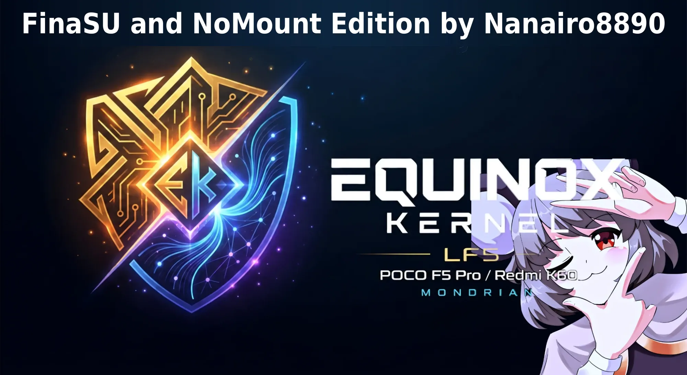

# Equinox MistOS FinaSU Edition by Nanairo8890

**POCO F5 Pro / Redmi K60** · `mondrian` · Snapdragon 8+ Gen 1 · **MistOS 5.1 Beta**

**Developer:** [LF52406](https://github.com/LF52406) · **[Download builds](../../releases)**

---

> [!NOTE]
> **This repository is the FinaSU edition of Equinox for MistOS**, made by **Nanairo** with
> LF52406's permission. It is Equinox 5.10.269 as released, with these changes:
>
> - **[FinaSU](https://github.com/LyraVoid/FinaSU)** by LyraVoid (a fork of [KernelSU](https://github.com/tiann/KernelSU)) instead of KernelSU-Next, as the `KernelSU/` submodule at `be19eb90` (`v1.2.1`, version 33074), built into the kernel. Use the **official FinaSU manager** (`FinaSU_v1.2.1_33074-release.apk`, package `me.yuki.fina`): the kernel trusts that manager's signing certificate in FinaSU's release trust slot, and other KernelSU-family managers are recognized but never granted. FinaSU uses UAPI 6.
> - **SUSFS v2.3.0** from [simonpunk's](https://gitlab.com/simonpunk/susfs4ksu) `gki-android12-5.10` branch at `eb95da0`, through FinaSU's SUSFS support.
> - **BBR** as the default TCP congestion control.
> - **[NoMount](https://github.com/maxsteeel/nomount) v2.2.0** by maxsteeel built in (`fs/nomount`), which includes deref3046's fix. FinaSU detects the built-in driver and uses it as the **NoMount** mount backend, so **no metamodule is needed** (choose NoMount in the manager; remove the NoMount metamodule if installed). Processes that FinaSU/SUSFS umount modules for see the stock filesystem, and NoMount is hidden from `/sys/module` and `/proc/kallsyms`.
> - **Extra `/proc/kallsyms` hiding** (r2): FinaSU exports many driver symbols whose names do not start with the usual KernelSU/SUSFS prefixes, so SUSFS's filter left them visible. The filter now also hides those, each one checked against a clean Equinox build so only FinaSU's own symbols are hidden.
>
> Everything else, DroidSpaces included, is LF52406's work, described below. The official Equinox
> builds are at [LF52406/Equinox-Kernel-sm8450](https://github.com/LF52406/Equinox-Kernel-sm8450).
> Report problems with this edition to Nanairo8890, not to LF52406 or LyraVoid.
>
> Build: `CLANG_DIR=/path/to/clang/bin scripts/equinox/build-finasu.sh`, then `scripts/equinox/package-finasu.sh` · Changes: [release notes](scripts/equinox/release-notes/5.10.269-finasu-r2.md) · Changelog: [English](CHANGELOG.en.txt) · [Español](CHANGELOG.es.txt) · [Português (Brasil)](CHANGELOG.pt-BR.txt) · [Русский](CHANGELOG.ru.txt)

---

## Current Build

| Component | Current |
|:--|:--|
| **Linux** | `5.10.269-Nanairo-FinaSU` |
| **Compatibility** | MistOS 5.1 Beta 17.0 (Android 17); tested on build 20261025 |
| **FinaSU** | `v1.2.1` (33074), built in |
| **SUSFS** | `2.3.0` (`eb95da0`) |
| **NoMount** | `v2.2.0` built in |
| **DroidSpaces** | Supported |
| **TCP** | BBR default · CUBIC available |
| **Toolchain** | AOSP Clang `22.0.0` (r584948) |
| **Build** | ThinLTO · Clang CFI · MODVERSIONS |
| **KMI** | Verified against clean Equinox 5.10.269 |

---

## Features

| Group | Included |
|:--|:--|
| **Root & hiding** | FinaSU integration · SUSFS · extra `/proc/kallsyms` hiding |
| **Containers** | DroidSpaces · PID namespaces · IPC / SYSVIPC |
| **Networking** | TCP BBR · runtime congestion-control switching |
| **Device** | mondrian production config · Goodix touch stability fixes |
| **Packaging** | Verified AnyKernel3 release package |

---

## Latest Changes

### 5.10.269 r2

- FinaSU `v1.2.1` (33074) built in, with the official FinaSU manager trusted in the release signature slot
- SUSFS updated to `eb95da0` (v2.3.0), which fixes a use-after-free in the priority-uid filter
- NoMount `v2.2.0` by maxsteeel built in; used as FinaSU's built-in NoMount backend, no metamodule needed
- Extra `/proc/kallsyms` hiding for FinaSU's own driver symbols, validated against clean Equinox
- Kernel named `5.10.269-Nanairo-FinaSU`
- Vendor module CRCs checked against MistOS 5.1 Beta 20261025, 20261024, 20261023 and 20261011, and MistOS 5.0 Alpha 20260914
- KMI verified against clean Equinox 5.10.269

[View full release notes](../../releases)

---

## Downloads & Flashing

Builds are published through **GitHub Releases**, with the SHA256 of each file on the release page.

**Current package:** `Equinox-5.10.269-FinaSU-mondrian-20261027.zip`

Download the release asset and flash the AnyKernel3 ZIP using a compatible recovery or kernel flasher. The ZIP only replaces the kernel `Image`; if you update MistOS, flash it again afterwards. Install the FinaSU manager from the release to manage root, modules and SUSFS.

> GitHub-generated `Source code` archives are not flashable kernel packages.

---

## Other AOSP ROMs

The ZIP keeps the ROM's vendor modules (`vendor_boot` and `vendor_dlkm`), and those only load on a kernel with the same symbol CRCs (KMI) as the kernel they were built with. A single `Image` therefore works on the ROMs whose kernel comes from the same source as Equinox, not on every ROM:

| ROM kernel source | Linux | Status |
|:--|:--|:--|
| MistOS 5.1 Beta / 5.0 Alpha | 5.10.269 | Tested |
| LineageOS `lineage-24.0` (Android 17) and `lineage-23.2` (Android 16 QPR2), and ROMs built on them | 5.10.269 | Expected to work: same tree as Equinox |
| LineageOS `lineage-23.0` / `lineage-23.1` (Android 16) | 5.10.247 | Not verified |
| LineageOS `lineage-22.2` (Android 15) | 5.10.245 | Not verified |
| HyperOS / MIUI | | Not supported |

Packages made with `scripts/equinox/package-finasu.sh` check this before flashing: `kmicheck` reads the ROM's modules from `vendor_boot` and `vendor_dlkm` and compares them with the kernel's own symbol table (`kmi.symvers`). If any module would be rejected (different CRC, a symbol this kernel does not export, a duplicate export or a different vermagic), the installer stops before writing anything and lists the modules. A ZIP with `nocheck` in its file name skips the check; one with `checkonly` runs the check and flashes nothing, to find out whether a ROM is compatible. The r2 package predates this check.

---

## Reporting Issues

When reporting a problem to Nanairo8890, include the kernel version, a short reproduction description and relevant logs such as `dmesg`, `logcat`, `pstore / ramoops`, or watchdog / panic logs when available.

---

## Support Development

If you find **Equinox Kernel** useful and would like to support its continued development, donations are always appreciated but entirely optional.

---

## Credits & Upstreams

- [**LF52406**](https://github.com/LF52406) — Equinox Kernel, the base of this edition
- [**LineageOS/android_kernel_xiaomi_sm8450**](https://github.com/LineageOS/android_kernel_xiaomi_sm8450) — primary kernel base used by Equinox
- [**LineageOS/android_kernel_qcom_sm8450**](https://github.com/LineageOS/android_kernel_qcom_sm8450) — Qualcomm common-kernel upstream used by Equinox
- [**Android Common Kernel**](https://android.googlesource.com/kernel/common) / [**Linux Kernel**](https://www.kernel.org/) — Android kernel infrastructure and upstream Linux
- [**FinaSU**](https://github.com/LyraVoid/FinaSU) by **LyraVoid**, based on [**KernelSU**](https://github.com/tiann/KernelSU) by **tiann** — kernel root implementation of this edition
- [**SUSFS**](https://gitlab.com/simonpunk/susfs4ksu) by **simonpunk** — SUSFS integration for Linux 5.10
- [**DroidSpaces**](https://github.com/ravindu644/Droidspaces-OSS) by **ravindu644** — container runtime and kernel requirements
- [**NoMount**](https://github.com/maxsteeel/nomount) by **maxsteeel**, with a fix by **deref3046** — VFS path redirection, built in as FinaSU's NoMount backend
- [**AnyKernel3**](https://github.com/osm0sis/AnyKernel3) by **osm0sis** — flashable kernel packaging
- [**Nanairo8890**](https://github.com/nanairo8890) — FinaSU, SUSFS, BBR and NoMount integration of this edition

Thanks to Qualcomm, LineageOS contributors, Android Common Kernel contributors, and the broader Linux kernel community for the upstream kernel, platform, and driver work that Equinox builds upon.
